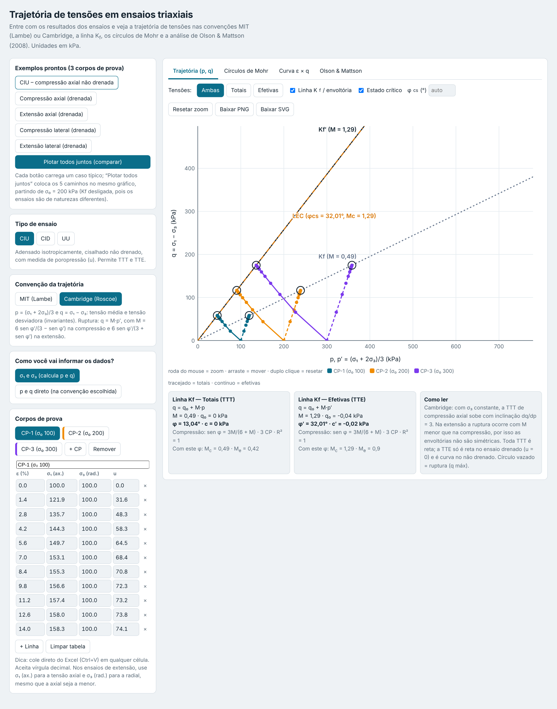
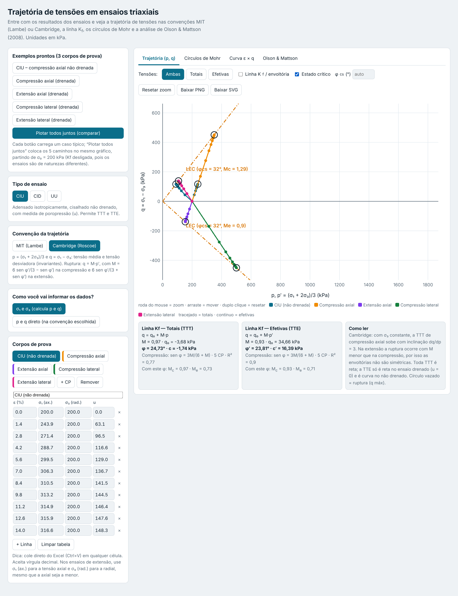
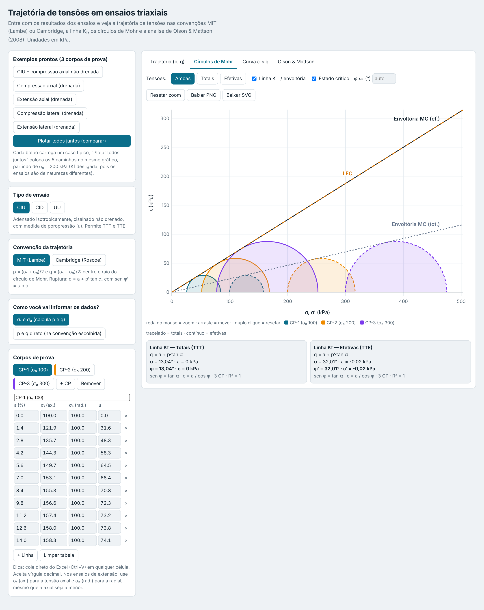
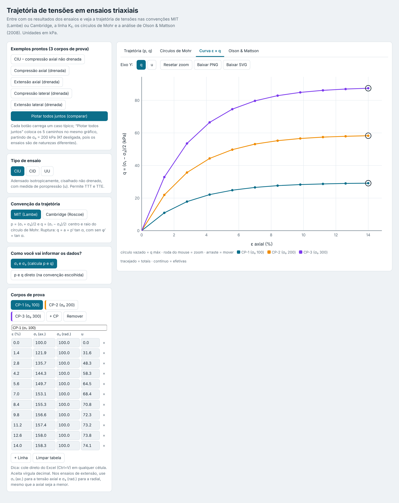

# Interpretação de ensaios triaxiais

App de engenharia geotécnica para **trajetórias de tensões (p, q) nas convenções MIT e Cambridge**, **linha K<sub>f</sub>**, **círculos de Mohr** e **resistência não drenada (Olson & Mattson, 2008)** a partir de resultados de ensaios triaxiais CIU, CID e UU.

É um único arquivo HTML: abra com duplo clique no navegador, sem instalar nada e sem internet.


## Veja o app em ação

### Trajetória de tensões (p, q), K<sub>f</sub> e estado crítico
Tensões totais (tracejado) e efetivas (contínuo) no mesmo gráfico, ruptura marcada em cada corpo de prova, linha K<sub>f</sub> ajustada por regressão e φ′, c′ calculados na hora.


### Convenção de Cambridge
Um clique troca a trajetória para p = (σ₁ + 2σ₃)/3 e q = σ₁ − σ₃. A ruptura vira q = M·p′, com M de compressão e de extensão calculados a partir de φ′.



Na comparação dos exemplos fica visível a diferença entre compressão (M<sub>c</sub>) e extensão (M<sub>e</sub>):



### Círculos de Mohr e envoltória de resistência
Círculos na ruptura de cada corpo de prova, com a envoltória de Mohr-Coulomb e a linha de estado crítico.



### Curva ε × q (e ε × u)
Comportamento tensão-deformação de cada corpo de prova. No CIU, dá para trocar o eixo Y para a poropressão.



### Olson & Mattson (2008)
Resistência não drenada normalizada S<sub>u</sub>/σ′<sub>3c</sub> no pico e no fim do ensaio, com a média.


### Comparação entre tipos de carregamento
Um clique plota compressão e extensão, axial e lateral, mais o CIU, partindo da mesma tensão inicial. Dá para ver como cada caminho de tensões se comporta.


## Funcionalidades

- **Convenção MIT (Lambe) ou Cambridge (Roscoe)** para a trajetória, com conversão automática dos dados da tabela.
- **Tipos de ensaio:** CIU, CID e UU. No CIU há coluna de poropressão (u) e é possível ver tensões totais (TTT), efetivas (TTE) ou ambas.
- **Entrada de dados:** informe σ₁ e σ₃ (o programa calcula p e q) ou informe p e q diretamente. Aceita vírgula decimal e colagem direta do Excel.
- **Vários corpos de prova**, cada um com uma cor.
- **Trajetória (p, q) de Lambe**, com a ruptura marcada no ponto de q máximo.
- **Linha K<sub>f</sub>**, ajustada por regressão linear entre os pontos de ruptura, com α, a, φ e c.
- **Círculos de Mohr** na ruptura e **envoltória de Mohr-Coulomb**.
- **Linha de estado crítico** (φ<sub>cs</sub> informado ou estimado do φ′ ajustado).
- **Curva ε × q** (e ε × u nos ensaios CIU).
- **Análise de Olson & Mattson (2008)** da resistência não drenada normalizada.
- **Exemplos prontos:** CIU, compressão axial, extensão axial, compressão lateral e extensão lateral, além do botão que plota todos juntos para comparação.
- **Zoom** com a roda do mouse, arrastar para mover e **exportação** em PNG e SVG.

## Fórmulas

Convenção MIT (Lambe), para σ₂ = σ₃:

```
p  = (σ₁ + σ₃) / 2        p′ = p − u
q  = (σ₁ − σ₃) / 2        q′ = q
```

Linha K<sub>f</sub> no plano p–q: `q = a + p·tan α`, com

```
sen φ = tan α        c = a / cos φ
```

Convenção de Cambridge (Roscoe), com σ₁ = tensão axial e σ₃ = tensão radial:

```
p  = (σ₁ + 2σ₃) / 3       p′ = p − u
q  = σ₁ − σ₃
```

Ruptura no plano p–q: `q = q₀ + M·p′`, com

```
compressão (q > 0):  M = 6 sen φ′ / (3 − sen φ′)    sen φ′ = 3M / (6 + M)
extensão   (q < 0):  M = 6 sen φ′ / (3 + sen φ′)    sen φ′ = 3M / (6 − M)
```

Resistência não drenada normalizada (Olson & Mattson, 2008):

```
Su / σ′₃c = (σ₁ − σ₃) / (2σ₃)
```

onde S<sub>u</sub> = q (valor máximo ou final) e σ′<sub>3c</sub> é a tensão confinante efetiva de adensamento, tomada na primeira linha de cada ensaio.

## Como usar

Abra o `index.html` em qualquer navegador moderno. Para publicar online, ative o GitHub Pages em **Settings → Pages → Deploy from a branch → `main` / root**.

## Observações

- Unidades em kPa.
- Os círculos de Mohr e a análise de Olson & Mattson usam sempre (σ₁ − σ₃)/2, independentemente da convenção escolhida.
- Os exemplos prontos e as imagens acima usam dados sintéticos (φ′ = 32°), apenas para demonstração.
- A ruptura é tomada como o ponto de q máximo de cada ensaio.
- Ferramenta de apoio ao estudo; não substitui a análise de um engenheiro geotécnico.

## Licença

[MIT](LICENSE)
